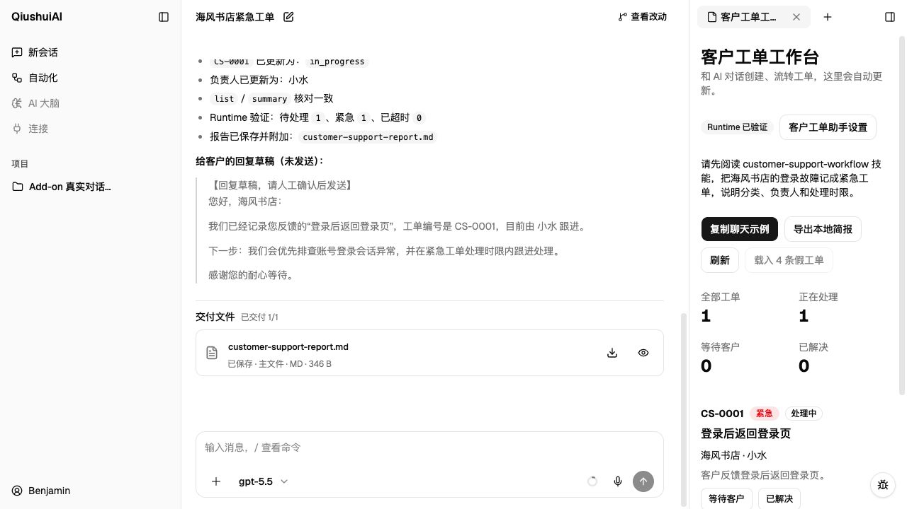
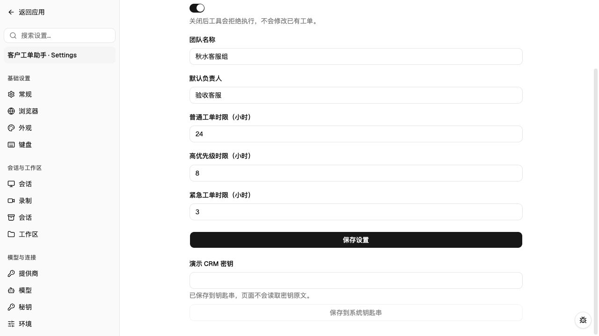

# 客户工单助手：用一个例子理解 Add-on

把它想成一个小客服办公室：**Skill 是操作手册，Extension 是能办事的员工，设置页是办公室规章，工作台是工单白板，Package 是整套办公室。**

所有客户、密钥和工单都是演示数据；不连接真实 CRM，不发送短信、邮件或企微，不做多人审批、附件管理、复杂搜索或定时任务。

## 安装之后，究竟在哪里用？

| 入口 | 你在这里做什么 |
| --- | --- |
| 设置 → 插件 → 查看详情 | 看介绍，通过按钮前往设置或工作台；这里不处理工单 |
| 设置 → 客户工单助手 | 配置团队、默认负责人、普通/高/紧急时限、启用开关、演示密钥 |
| 聊天右上角 → 工作区 → 客户工单工作台 | 看真实工单、手动变更状态、下载简报；聊天修改后约 3 秒自动更新 |
| 聊天输入框 | 直接告诉 AI：创建、查询、跟进、关闭、汇总工单 |

**还要给项目启用它：**在项目菜单 → 项目配置 → 插件，勾选全局安装的 `customer-support-demo` 并保存。安装是“买好工具箱”，项目启用才是“让这个项目的 AI 使用它”。新开聊天测试最稳妥。

### 跟着做一遍

1. 设置页把默认负责人改为“验收客服”，紧急时限改为 3 小时，保存。
2. 新建真实聊天，发送：

   > 请先读取 customer-support-workflow 技能和分类、优先级规则，再把海风书店的登录故障记成紧急工单。告诉我编号、负责人和处理时限。

3. 打开工作台。聊天创建的工单应显示在这里，负责人应为“验收客服”。
4. 继续发：

   > 先读刚才的工单，再改为处理中，交给小水。写一份回复客户的草稿，不要发送。

5. 再发：

   > 客户确认问题已解决，请关闭工单并汇总。生成工单简报，保存到项目目录，并作为可下载文件交付。

不要只看 AI 说“成功”。展开聊天调用记录，应能看到读取 Skill、规则或模板，以及实际的 `support_ticket` 调用；工单状态和文件也必须真实存在。





## 这个办公室是怎么协作的？

| 能力 | 本例的实际效果 | 开发位置 |
| --- | --- | --- |
| Package | 一次安装工具、Skill、页面与 Runtime | `package.json` 的 `pi` 字段 |
| Extension 工具 | `support_ticket` 创建、查询、更新、关闭、汇总、重置、载入演示数据、生成报告、查询 Runtime | `index.ts` |
| Skill + 参考资料 | AI 按客服流程做事，读分类/优先级规则，用模板写草稿 | `skills/customer-support-workflow/` |
| 生命周期提示 | 每轮提醒模型只操作虚拟数据，不谎称发过消息 | `before_agent_start` |
| 设置页 | 普通设置保存后影响下一条新工单；关闭开关后工具拒绝执行 | `CustomerSupportSettings` |
| 工作区页面 | 与聊天并排看工单，也能手动改状态 | `CustomerSupportWorkbench` |
| 直接配置 API | 页面和工具操作同一套工单服务，不借用斜杠命令 | `/agent/addons/api/customer-support-demo/` |
| 全局 KV | 工单、配置、最近操作跨聊天共享，重启后保留 | `ticket-store.ts`、`config.ts` |
| 会话 KV | 每个聊天单独统计 `sessionCalls`，从 1 开始 | 宿主真实 chatJid 作为 owner |
| Keychain | 假密钥加密保存在系统凭据库；页面只显示“已保存” | `/agent/keychain` |
| Runtime | 按需注册状态提供者，工具/工作台读取真实摘要 | `runtime/index.ts` |
| 文件产物 | 页面下载 Markdown；聊天调用 report 后由宿主文件/交付工具保存并交付 | `report` |
| 主题与语言 | 使用宿主 React、shadcn/Base UI、中文/英文及深浅色 token | `web/` |

钥匙串只是演示安全保存，**本例不使用密钥连接任何真实服务**。聊天里的可下载文件由 Add-on 生成内容、宿主负责文件交付，不是 Add-on 自建附件系统。

## 本地开发：不用发布

在 `qiushuiai-addons` 仓库执行：

```bash
bun run addon:dev customer-support-demo --home /你的隔离测试目录/home
bun run addon:verify customer-support-demo
```

这是**本地安装源码快照**，不提交代码、不上传、不公开发布。修改源码后再跑一次 `addon:dev`，重启对应 QiushuiAI 实例、刷新页面并开新聊天测试。原安装保留在 `system/addons/dev-backups/`。

为什么不是软链接？当前宿主的任务能力加载器拒绝包目录逃逸。Web 能加载软链接，不代表聊天工具也能加载；不要为了开发体验绕过这层保护。

启动宿主时同时设置隔离的 `QIUSHUIAI_HOME`、`QIUSHUIAI_STORE`、`QIUSHUIAI_DATA`，并复用该测试环境自己的加密密钥。不要指向生产数据目录。

## 目录导览

```text
customer-support-demo/
├── package.json                    # 整套能力的装箱清单
├── index.ts                        # AI 工具、生命周期、页面 API
├── config.ts                       # 配置读取、默认值与校验
├── ticket-store.ts                 # 工单业务与持久化
├── compat/extension-kv.ts           # 宿主 KV 桥接；真实宿主失败时拒绝内存回退
├── runtime/index.ts                # 按需状态提供者，不跑定时任务
├── web/
│   ├── index.tsx                   # 分开的设置页与工作台
│   ├── host.ts                     # React/shadcn 宿主类型契约
│   ├── api.ts                      # 类型化 API 客户端
│   ├── translations.ts             # 中文、英文文案
│   └── styles.ts                   # 只做布局，颜色使用宿主语义 token
├── skills/customer-support-workflow/
│   ├── SKILL.md                    # 工作流程
│   ├── references/
│   │   ├── category-rules.md        # 分类依据
│   │   └── priority-rules.md        # 优先级依据
│   └── assets/reply-template.md    # 回复草稿模板
├── assets/                         # 真实浏览器截图
├── ACCEPTANCE.md                   # 实测步骤、证据与能力边界
└── *.test.ts                       # 工具、业务、Web 契约及 Runtime 测试
```

## 后续开发者必须知道的边界

- **UI 业务写在插件里，通用入口写在宿主里。**不要在 QiushuiAI 的插件详情弹窗里硬编码客服界面。
- 当前 QiushuiAI 的 KV 使用宿主白名单声明。本例需要宿主的 `createAddonStorage` 和 `EXTENSION_STATE_DECLARATIONS` 同步登记；复制本插件、只改名字不会自动获得持久化能力。这是当前接口限制，不是通用第三方存储 SDK。
- 会话 owner 是宿主 chatJid，不是 Pi 的 session UUID。两者混用会导致“工具修改了工单，但计数写入失败”。
- 密钥只进 Keychain；KV 只保存密钥引用。
- 已有工单时 `seed_demo` 拒绝覆盖。先导出，明确确认后才可以 `reset_demo`；重置不清除设置和密钥。
- 本例不是 Piclaw 全部 API 的实现。通道/跨实例消息、外部 HTTP 路由、音视频流等其他 Runtime API 均未演示；这些与用户明确排除的真实业务集成不是本例验收范围。

设置与工作区分工依据原 Piclaw 的 `registerSettingsPane` / `registerWorkspacePane` 设计；其旧前端技术没有照搬。来源见仓库根 [Piclaw 调研记录](../../PICLAW-ADDONS-UI-USAGE-RESEARCH.md)。
